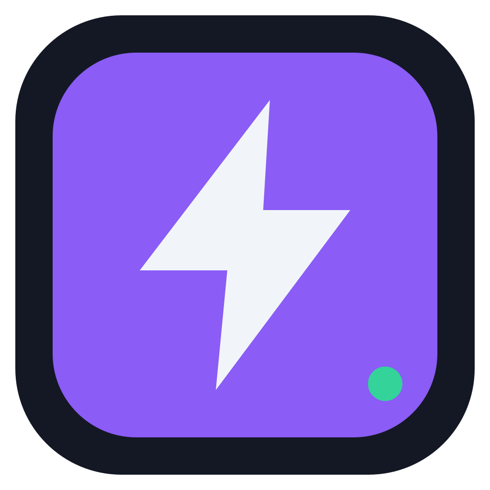

<p align="center">
  
</p>

<h1 align="center">CLEX Flow</h1>
<p align="center">Визуальная среда разработки для микроконтроллеров</p>
<p align="center"><strong>0.1.1 · В разработке · macOS / Windows · MIT</strong></p>

Визуальная среда разработки для микроконтроллеров и одноплатных компьютеров. Плата, аппаратные подключения и блоки логики объединяются в одном проекте. Проекты, инструменты и данные остаются на вашем компьютере.

CLEX Flow развивается с прицелом на семейства ESP, платы Arduino и Raspberry Pi.

Приложение находится в активной разработке. Стабильного релиза пока нет.


## Возможности

- **Проекты:** локальные JSON-файлы, поиск, импорт, экспорт и защита несохранённых изменений.
- **Библиотека:** просмотр встроенных компонентов, логических блоков и плат с поиском.
- **Монтаж:** холст React Flow со SVG-изображениями плат, светодиод, кнопка, TFT-дисплей и встроенный Ethernet для плат с реализованным драйвером, соединения и проверки GPIO; выбор стороны каждого контакта.
- **Сохранение:** автосохранение всего проекта через 10 секунд без правок либо ручной режим; переключатель в настройках студии.
- **Логика:** таймер, счётчик, Ethernet, проверка HTTP/HTTPS-ресурса, чтение, установка и переключение GPIO, сообщения в Serial и связанный экран дисплея. Понятные подписи и подсказки контактов, подсветка совместимых соединений, дополнительные контакты, типизированные связи и Undo/Redo. Разные цвета маршрутов, пунктир сигналов и выделение связанных линий.
- **Дисплеи:** единый редактор фона и текста, перемещение, координаты, цвета, шрифты с кириллицей и предпросмотр в логическом блоке. Помощник привязки числовых, логических и текстовых выходов графа к элементам экрана, ручные соединения, префиксы и суффиксы. Настраиваемые индикаторы состояний с независимыми привязками и динамической надписью. Первый драйвер: ST7789 SPI через ESP-IDF и LVGL.
- **Сеть:** реальные Link, IP, маска, шлюз и DNS через ESP-IDF; DHCP и статический IPv4. Фоновая проверка выбранного HTTP/HTTPS-ресурса с интервалом и таймаутом. Первый аппаратный драйвер: W5500.
- **SDK Manager:** обнаружение существующей ESP-IDF, несколько установок, выбор окружения, установка через официальный EIM с подтверждением и удаление управляемых SDK.
- **Прошивка:** детерминированный генератор C/CMake, просмотр исходников, сборка через существующую ESP-IDF и журнал компилятора с автоматической прокруткой и возвратом к последним сообщениям.
- **Подключение:** автоматическое обнаружение и выбор единственного USB-порта, ручной выбор при нескольких устройствах, запись актуальной сборки с подтверждением и монитор 115200 бод.

Без сервера, регистрации, облака и телеметрии.

## Монтаж

Выберите плату, добавьте компоненты и соедините их физические контакты. Редактор проверяет допустимость GPIO, конфликты, питание и параметры компонентов.


## Визуальная логика

Соедините таймер с действием или счетчиком. Выходы сетевых блоков можно подключить к тексту и индикаторам дисплея через помощник «Подключить данные». Схема и привязки сохраняются вместе с проектом.


## Дисплеи

Двойное нажатие на блок «Экран дисплея» открывает общий редактор. Интерфейс сохраняется в проекте и включается в прошивку. Сейчас реализован TFT-модуль SPI 240×320 на ST7789 с внутренней подсветкой; поддержка других модулей расширяется отдельными описаниями и драйверами.


Подробнее: [подключение, шрифты и расширение библиотеки](docs/displays.md).

## Платформы

Готовые установщики выпускаются для **macOS Apple Silicon (ARM64)** и **Windows x64**. Установщики: `.dmg` для macOS и `.exe` для Windows.

В версии **0.1.1** реализован генератор для **ESP32-S3**. Текущая интеграция требует установленную **ESP-IDF 5.4.4**; другие версии SDK пока не поддерживаются. Расширение совместимости с ESP-IDF предусмотрено в дальнейшем развитии проекта.

В каталоге доступны документированные профили:

- Waveshare ESP32-S3-ETH.
- Espressif ESP32-S3-DevKitC-1 v1.1 N8R8.

Поддержка других семейств ESP, плат Arduino и Raspberry Pi запланирована для следующих версий.

Подтверждена запись прошивки на Waveshare ESP32-S3-ETH и работа подключённого TFT-дисплея ST7789. Перед подключением сверяйте модель, ревизию и монтаж с документацией производителя.

## Установка

Откройте [GitHub Releases](https://github.com/proxymades/clex-flow/releases) и выберите предварительную версию с установщиком для вашей системы.

### macOS Apple Silicon

1. Скачайте файл `.dmg` для ARM64, откройте его и перенесите **CLEX Flow** в **Applications / Программы**.
2. Запустите приложение из папки **Программы**.
3. Если macOS блокирует первый запуск, откройте **Системные настройки → Конфиденциальность и безопасность** и разрешите запуск CLEX Flow кнопкой **Все равно открыть**. Разрешайте запуск только файла, скачанного из репозитория проекта.

У этой предварительной сборки нет подписи Developer ID и нотариализации. Локальная подпись ad-hoc обеспечивает запуск ARM64-приложения без сертификата разработчика. Подробнее: [Tauri](https://v2.tauri.app/distribute/sign/macos/#ad-hoc-signing), [инструкция Apple](https://support.apple.com/102445).

### Windows x64

1. Скачайте NSIS-установщик `.exe` и запустите его.
2. Следуйте шагам установки и откройте **CLEX Flow** из меню **Пуск**.
3. При предупреждении SmartScreen проверьте источник файла. Для доверенного установщика выберите **Подробнее → Выполнить в любом случае**, если эта возможность доступна. Политики рабочего компьютера могут требовать разрешения администратора.

Установщик не подписан сертификатом издателя. Для интерфейса нужен Microsoft Edge WebView2 Runtime; установщик Tauri проверяет его наличие. ESP-IDF и компиляторы устанавливаются отдельно через SDK Manager или обнаруживаются в существующей установке.

## Запуск для разработки

Нужны **Node.js 22.12+**, npm и Rust. На macOS также нужны Xcode Command Line Tools; на Windows – Build Tools for Visual Studio с инструментами C++ и WebView2. Для редакторов ESP-IDF не требуется; для сборки firmware в версии **0.1.1** нужна **ESP-IDF 5.4.4**. Её можно обнаружить или установить через «Инструменты разработки».

```sh
git clone https://github.com/proxymades/clex-flow.git
cd clex-flow
npm ci
npm run desktop
```

Сборка приложения:

```sh
npm run desktop:build
```

Результат на macOS: `src-tauri/target/release/bundle/macos/CLEX Flow.app`. Для установщиков `.dmg` (macOS) и `.exe` (Windows) используйте отдельные конфигурации и команды из [руководства по выпуску версий](docs/releases.md).

Для веб-предпросмотра запустите `npm run dev` и откройте `http://127.0.0.1:1420`. В браузере проекты хранятся в localStorage; десктопная версия использует файловое хранилище. Скриншоты показывают интерфейс с демонстрационным проектом.

## Технологии

Tauri 2 · Rust · React 19 · JavaScript/JSX · Vite · React Flow · CSS · Lucide · JSON/SVG · ESP-IDF · LVGL

## Проверки

```sh
npm run lint
npm test
npm run build
cargo fmt --manifest-path src-tauri/Cargo.toml --check
cargo test --manifest-path src-tauri/Cargo.toml --locked
```

UI-сценарии используют Playwright: `test:ui`, `test:assembly-ui`, `test:logic-ui`, `test:firmware-ui`. Запускайте их при работающем веб-предпросмотре и установленном Chromium. Результаты сохраняются локально в `.artifacts/`.

## Документация

- [SDK Manager](docs/sdk-manager.md)
- [Подключение ESP-IDF и сборка firmware](docs/esp-idf.md)
- [Профили плат и распиновка](docs/boards.md)
- [Дисплеи и Unicode](docs/displays.md)
- [Сеть и индикаторы состояния](docs/network.md)
- [Редактор логики](docs/logic.md)
- [Формат проектов](docs/project-format.md)
- [Модули компонентов](docs/module-format.md)
- [Архитектура](docs/architecture.md)
- [Сборка установщиков и выпуск версий](docs/releases.md)
- [Изменения](CHANGELOG.md)

## Лицензия

Оригинальный код – [MIT License](LICENSE). Лицензии и уведомления сторонних библиотек сохранены в [THIRD_PARTY_NOTICES.md](THIRD_PARTY_NOTICES.md).
