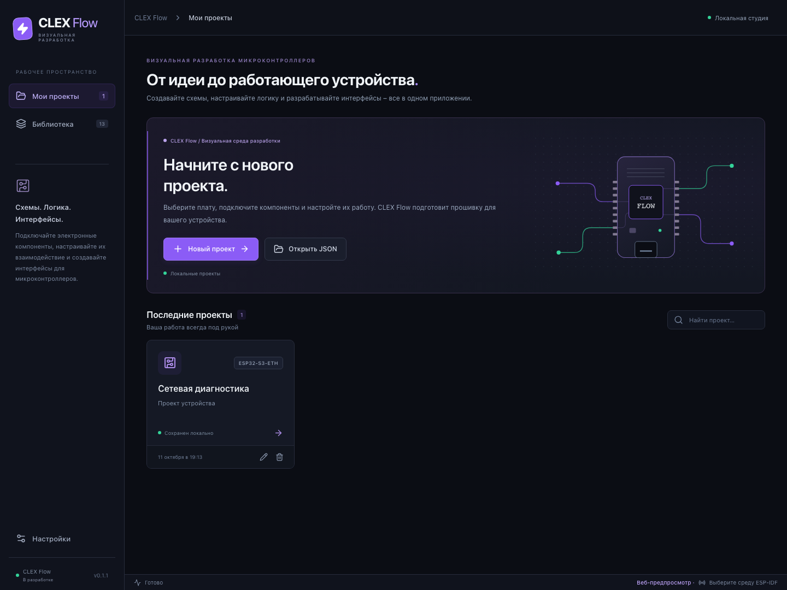
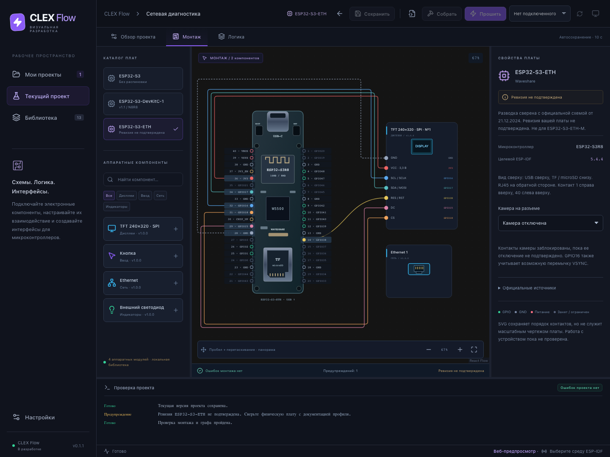
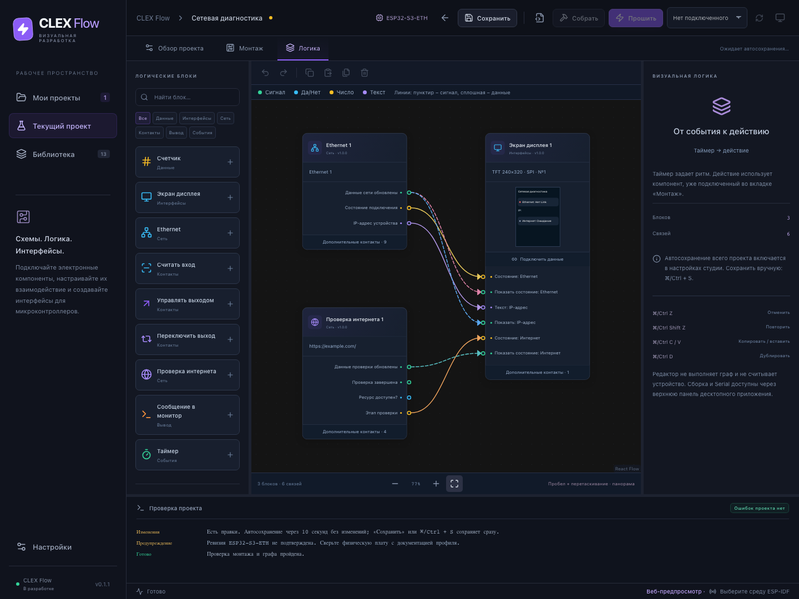
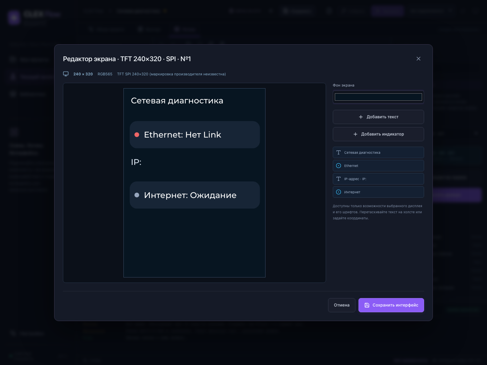

<p align="center">
  
</p>

<h1 align="center">CLEX Flow</h1>
<p align="center">Визуальная среда разработки для микроконтроллеров</p>
<p align="center"><strong>0.1.9 · Предварительная версия · macOS / Windows · MIT</strong></p>

Визуальная среда разработки для микроконтроллеров и одноплатных компьютеров. Плата, аппаратные подключения и блоки логики объединяются в одном проекте. Проекты, инструменты и данные остаются на вашем компьютере.

CLEX Flow развивается с прицелом на семейства ESP, платы Arduino и Raspberry Pi.

Приложение находится в активной разработке. Стабильного релиза пока нет.



## Возможности

- **Проекты:** локальные JSON-файлы, поиск, импорт, экспорт, выбор папки на другом диске и защита несохраненных изменений.
- **Выбор платы:** одна карточка текущей платы в «Монтаже» и общее окно выбора при создании проекта и смене платы. Поиск по модели и микроконтроллеру, фильтры по семейству и производителю, отдельная прокрутка каталога.
- **Библиотека:** просмотр встроенных компонентов, логических блоков и плат с поиском. В списках «Все» компоненты и блоки одной категории расположены рядом.
- **Монтаж:** холст React Flow со SVG-изображениями плат, светодиод, механическая и сенсорная кнопки, TFT-дисплей и встроенный Ethernet для плат с реализованным драйвером, соединения и проверки GPIO; выбор стороны каждого контакта. Короткие ортогональные линии и ручной сдвиг участков с сохранением маршрута. Отмена и повтор действий кнопками и ⌘/Ctrl+Z, включая компоненты с проводами, положения и ручные маршруты.
- **Сенсорная кнопка:** универсальный цифровой вход VCC/GND/OUT, активный HIGH/LOW и проверка напряжений через существующие блоки GPIO. [Подключение и настройки](docs/touch-button.md).
- **Шаговые двигатели:** общий NEMA 17 и драйверы TB6600, MKS TMC2208 V2 и DRV8825 для ESP32/ESP32-S3/P4 и Arduino Nano. Управление STEP/DIR, движение в шагах или оборотах, непрерывное вращение, разгон, остановка и отключение удержания. Ток и микрошаг на модуле настраиваются вручную. [Подключение и ограничения](docs/stepper.md).
- **Выбор по значению:** запуск одной из двух ветвей либо действия для остальных чисел по отдельному событию, с чтением последнего значения источника. Доступен для ESP32, ESP32-S3, ESP32-P4 и Nano. [Настройка и переключение ESP-NOW](docs/logic-selection.md).
- **Память режима ESP-NOW:** необязательное сохранение выбранного режима передачи на ESP32 и восстановление после отключения питания. [Настройка и обработка ошибок](docs/espnow-persistence.md).
- **Доступность устройств ESP-NOW:** проверка ответа выбранной платы, отдельный индикатор связи, актуальность RSSI и события потери/восстановления связи. [Настройка и таймауты](docs/espnow-health.md).
- **XGZP6847D:** давление и температура по I²C, выбор питания и коэффициента K, измерения автоматически или по событию, вывод в Serial, на дисплей и в MQTT. Поддерживаются ESP32, ESP32-S3, ESP32-P4 и Arduino Nano. [Подключение и настройка](docs/xgzp6847d.md).
- **Температура микроконтроллера:** встроенный датчик ESP32-S3/P4, автоматическое измерение или запуск по событию, вывод на дисплей и в Serial, явное состояние ошибки. [Настройка и особенности измерения](docs/temperature.md).
- **Wi-Fi:** подключение к существующей сети, DHCP или статический IPv4, автоматическое восстановление, управление и диагностика из логики. Поддерживаются ESP32, ESP32-S3 и ESP32-P4 Nano; на P4 используется ESP32-C6. [Настройка подключения](docs/wifi.md).
- **Wi-Fi маршрутизатор:** Ethernet или Wi-Fi WAN, Wi-Fi SoftAP либо Ethernet LAN, IPv4 NAPT, DHCP, локальный DNS UDP/TCP и резервный WAN. Общая реализация для существующих S3-профилей и P4 Nano через ESP-Hosted; локальное управление с аутентификацией и OTA. [Возможности, настройка и ограничения](docs/router.md). [Пример ESP32-S3-ETH с дисплеем и температурой](examples/router-esp32-s3-eth-test.clex.json).
- **Сохранение:** автосохранение всего проекта через 10 секунд без правок либо ручной режим; переключатель в настройках студии.
- **Логика:** таймер, счетчик, секундомер с выводом чч:мм:сс, Ethernet, проверка HTTP/HTTPS-ресурса, чтение, установка и переключение GPIO, сообщения в Serial и связанный экран дисплея. Понятные подписи и подсказки контактов, подсветка совместимых соединений, постоянно видимые контакты, типизированные связи и Undo/Redo. Разные цвета маршрутов, пунктир сигналов и выделение связанных линий.
- **Реле:** модули с числом каналов от 1 до 16, управление LOW/HIGH, выбор напряжения питания и внешнего источника. Питание от платы доступно для 3,3 и 5 В при совпадении напряжения контакта, с предупреждением о нагрузке. Выбор канала, включение, выключение и переключение из логики. [Настройка и подключение](docs/relays.md).
- **Дисплеи:** единый редактор фона, текста и PNG-логотипов с прозрачностью; заставка при запуске с заданным временем показа. Перемещение, координаты, цвета, шрифты с кириллицей и предпросмотр в логическом блоке. Помощник привязки числовых, логических и текстовых выходов графа к элементам экрана, ручные соединения, префиксы и суффиксы. Настраиваемые индикаторы состояний с независимыми привязками и динамической надписью. Драйверы ST7789 SPI и JD9365 MIPI-DSI через ESP-IDF и LVGL.
- **ESP-NOW (ESP32/ESP32-S3):** четыре логических блока и аппаратный компонент единой версии 2.0.0; сообщения и команды с подтверждениями, защищенные устройства, Normal/Long Range, счетчики и события входа/кнопки. [Настройки и проверка на двух платах](docs/espnow.md).
- **MQTT 3.1.1 / 5.0:** несколько программных подключений через существующие Wi-Fi/Ethernet, TLS с проверкой сертификата, QoS 0/1/2, LWT, сессии и восстановление подписок. Три блока: управление, отправка и получение; текстовые и бинарные payload, свойства MQTT 5. [Настройка и ограничения](docs/mqtt.md).
- **Сеть:** реальные Link, IP, маска, шлюз и DNS через ESP-IDF; DHCP и статический IPv4. Фоновая проверка выбранного HTTP/HTTPS-ресурса с интервалом и таймаутом. Аппаратные драйверы: W5500 SPI и IP101/RMII.
- **Аудио и камера P4:** звуковой сигнал через ES8311/I2S; захват кадров OV5647/CSI с результатом и диагностикой. Подключения и конфликты ресурсов учитываются в монтаже.
- **Подготовка инструментов:** общая проверка ESP32, ESP32-S3, ESP32-P4 и Arduino AVR, выбор папки новых инструментов, оценка загрузки и установка недостающих пакетов с подтверждением. Готовые внешние установки сохраняются.
- **SDK Manager:** обнаружение существующей ESP-IDF, включая другие диски Windows и установки Espressif Tools Installer / EIM, несколько установок, выбор окружения, установка через официальный EIM с подтверждением и удаление управляемых SDK.
- **Прошивка:** детерминированный генератор C/CMake, просмотр исходников, сборка через ESP-IDF либо Arduino CLI и журнал компилятора с автоматической прокруткой и возвратом к последним сообщениям.
- **Подключение:** автоматическое обнаружение и выбор единственного USB-порта, ручной выбор при нескольких устройствах, запись актуальной сборки с подтверждением и монитор 115200 бод.

Без сервера, регистрации, облака и телеметрии.

## Монтаж

Выберите плату, добавьте компоненты и соедините их физические контакты. Редактор проверяет допустимость GPIO, конфликты, питание и параметры компонентов.



## Визуальная логика

Соедините таймер с действием или счетчиком. Выходы сетевых блоков можно подключить к тексту и индикаторам дисплея через помощник «Подключить данные». Схема и привязки сохраняются вместе с проектом.



## Дисплеи

Двойное нажатие на блок «Экран дисплея» открывает общий редактор. Интерфейс сохраняется в проекте и включается в прошивку. Реализованы TFT SPI 240×320 на ST7789 и Waveshare 10.1-DSI-TOUCH-A 800×1280 на JD9365 с GT9271. Библиотека расширяется отдельными описаниями и драйверами.



Подробнее: [подключение, шрифты и расширение библиотеки](docs/displays.md).

## Платформы

Готовые установщики выпускаются для **macOS Apple Silicon (ARM64)** и **Windows x64**. Установщики: `.dmg` для macOS и `.exe` для Windows.

В текущих исходниках реализован генератор для **ESP32**, **ESP32-S3**, **ESP32-P4** и **Arduino Nano ATmega328P/CH340G**. Интеграция ESP32 требует установленную **ESP-IDF 5.4.4**; другие версии SDK пока не поддерживаются. Расширение совместимости с ESP-IDF предусмотрено в дальнейшем развитии проекта.

В каталоге доступны документированные профили:

- ESP32 DevKit V1 (30 pin), ESP32-WROOM-32: 4 МБ Flash, UART через USB-UART. [Распиновка, совместимость и прошивка](docs/esp32-devkit-v1.md).
- Waveshare ESP32-S3-ETH.
- Espressif ESP32-S3-DevKitC-1 v1.1 N8R8.
- Arduino Nano ATmega328P/CH340G с USB Type-C: Arduino AVR Boards 1.8.6, обычный и старый загрузчик, GPIO, таймер, счетчик, секундомер, Serial и шаговые двигатели. [Подготовка и первый проект](docs/arduino-nano.md).
- ESP32-P4-NANO от Waveshare, включая плату из комплекта KIT-C. Сборка RISC-V, консоль UART через USB-C, GPIO, SPI-дисплей и встроенный Ethernet IP101/RMII. Ревизия ESP32-P4 выбирается в свойствах платы.

Профиль ESP32 DevKit V1 доступен начиная с версии 0.1.8.

Описание P4, распиновка и встроенные интерфейсы: [ESP32-P4-NANO](docs/esp32-p4-nano.md).

Поддержка других семейств ESP, моделей Arduino и Raspberry Pi запланирована для следующих версий.

На ESP32 DevKit V1 проверена прошивка через USB-UART. Аппаратная проверка отдельных периферийных сценариев остается открытой.

На оборудовании проверены прошивка и работа Waveshare ESP32-S3-ETH, ESP32-P4-NANO и Arduino Nano, а также радиообмен ESP-NOW и переключение Normal/Long Range на двух ESP32-S3. На ESP32-S3-ETH проверена раздача интернета с W5500 на Wi-Fi-клиентов и вывод температуры кристалла на дисплей. Драйверы P4 DSI/touch, аудио ES8311 и камеры OV5647 прошли компиляцию, но требуют аппаратной проверки. Перед подключением сверяйте модель, ревизию и монтаж с документацией производителя.

## Установка

Откройте [GitHub Releases](https://github.com/proxymades/clex-flow/releases) и выберите предварительную версию с установщиком для вашей системы.

### macOS Apple Silicon

1. Скачайте файл `.dmg` для ARM64, откройте его и перенесите **CLEX Flow** в **Applications / Программы**.
2. Запустите приложение из папки **Программы**.
3. Если macOS блокирует первый запуск, откройте **Системные настройки → Конфиденциальность и безопасность** и разрешите запуск CLEX Flow кнопкой **Все равно открыть**. Разрешайте запуск только файла, скачанного из репозитория проекта.

У этой предварительной сборки нет подписи Developer ID и нотариализации. Локальная подпись ad-hoc обеспечивает запуск ARM64-приложения без сертификата разработчика. Подробнее: [Tauri](https://v2.tauri.app/distribute/sign/macos/#ad-hoc-signing), [инструкция Apple](https://support.apple.com/102445).

### Windows x64

1. Скачайте NSIS-установщик `.exe` и запустите его.
2. Следуйте шагам установки и откройте **CLEX Flow** из меню **Пуск**.
3. При предупреждении SmartScreen проверьте источник файла. Для доверенного установщика выберите **Подробнее → Выполнить в любом случае**, если эта возможность доступна. Политики рабочего компьютера могут требовать разрешения администратора.

Установщик не подписан сертификатом издателя. Для интерфейса нужен Microsoft Edge WebView2 Runtime; установщик Tauri проверяет его наличие. ESP-IDF и компиляторы устанавливаются отдельно через SDK Manager или обнаруживаются в существующей установке.

## Папка проектов

В десктопном приложении откройте **Настройки → Хранилище проектов → Выбрать папку**. Можно выбрать папку на другом доступном диске независимо от места установки CLEX Flow.

Приложение сохранит текущие правки и скопирует проекты в выбранную папку. Исходные файлы останутся в прежнем каталоге как резервная копия. Файлы с одинаковыми именами и разным содержимым не заменяются: выберите другую папку. Выбранный путь сохраняется после перезапуска и обычного обновления приложения. При недоступном диске приложение сообщает об ошибке; подключите диск перед продолжением работы.

## Запуск для разработки

Нужны **Node.js 22.12+**, npm и Rust. На macOS также нужны Xcode Command Line Tools; на Windows – Build Tools for Visual Studio с инструментами C++ и WebView2. Для редакторов ESP-IDF не требуется; для сборки firmware ESP32 в версии **0.1.7** нужна **ESP-IDF 5.4.4**. Ее можно обнаружить или установить через «Инструменты разработки».

```sh
git clone https://github.com/proxymades/clex-flow.git
cd clex-flow
npm ci
npm run desktop
```

Сборка приложения:

```sh
npm run desktop:build
```

Результат на macOS: `src-tauri/target/release/bundle/macos/CLEX Flow.app`. Для установщиков `.dmg` (macOS) и `.exe` (Windows) используйте отдельные конфигурации и команды из [руководства по выпуску версий](docs/releases.md).

Для веб-предпросмотра запустите `npm run dev` и откройте `http://127.0.0.1:1420`. В браузере проекты хранятся в localStorage; десктопная версия использует файловое хранилище. Скриншоты показывают интерфейс с демонстрационным проектом.

## Технологии

Tauri 2 · Rust · React 19 · JavaScript/JSX · Vite · React Flow · CSS · Lucide · JSON/SVG · ESP-IDF · LVGL

## Проверки

Для тестов прогресса загрузки нужен Python 3.9+ (`python3` либо `python`); установка ESP-IDF для этих тестов не требуется.

```sh
npm run lint
npm test
npm run build
cargo fmt --manifest-path src-tauri/Cargo.toml --check
cargo test --manifest-path src-tauri/Cargo.toml --locked
npm run test:firmware-parity
```

`test:firmware-parity` сравнивает файлы генератора JavaScript и нативного слоя Rust в 54 конфигурациях ESP32/S3/P4/Nano, включая ESP-NOW, маршрутизатор, шаговые двигатели и измерение температуры. ESP-IDF, сеть и устройство не нужны; сначала выполните Rust-тесты для подготовки зависимостей.

UI-сценарии используют Playwright: `test:ui`, `test:assembly-ui`, `test:logic-ui`, `test:firmware-ui`. Запускайте их при работающем веб-предпросмотре и установленном Chromium. Для P4 и новых маршрутов доступны `test:p4-ui`, `test:peripheral-ui`, `test:manual-routing-ui`. URL предпросмотра задается через `CLEX_PREVIEW_URL`, путь Chromium при необходимости – через `CLEX_BROWSER_EXECUTABLE`. Результаты сохраняются локально в `.artifacts/`.

## Документация

- [SDK Manager](docs/sdk-manager.md)
- [Подключение ESP-IDF и сборка firmware](docs/esp-idf.md)
- [Профили плат и распиновка](docs/boards.md)
- [Дисплеи и Unicode](docs/displays.md)
- [Сеть и индикаторы состояния](docs/network.md)
- [Wi-Fi маршрутизатор](docs/router.md)
- [Шаговые двигатели](docs/stepper.md)
- [XGZP6847D](docs/xgzp6847d.md)
- [Температура микроконтроллера](docs/temperature.md)
- [Редактор логики](docs/logic.md)
- [Формат проектов](docs/project-format.md)
- [Модули компонентов](docs/module-format.md)
- [Архитектура](docs/architecture.md)
- [Сборка установщиков и выпуск версий](docs/releases.md)
- [Изменения](CHANGELOG.md)

## Лицензия

Оригинальный код – [MIT License](LICENSE). Лицензии и уведомления сторонних библиотек сохранены в [THIRD_PARTY_NOTICES.md](THIRD_PARTY_NOTICES.md).
