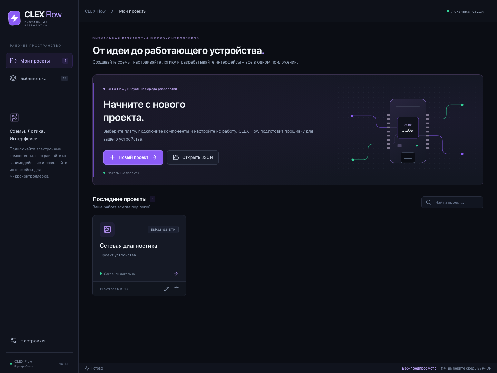
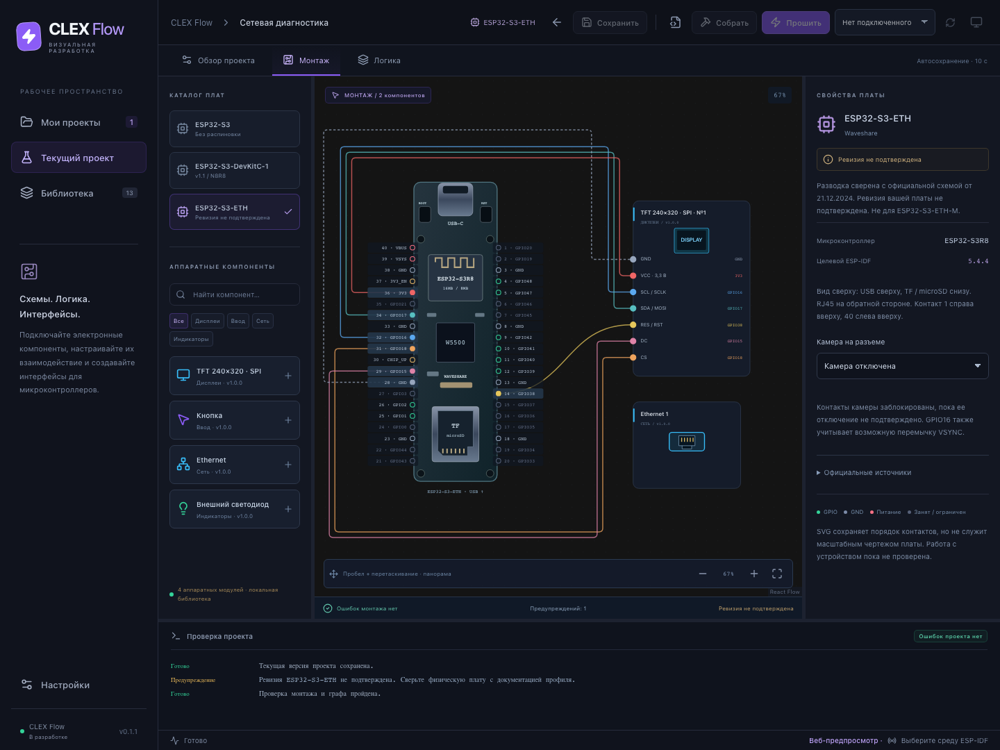
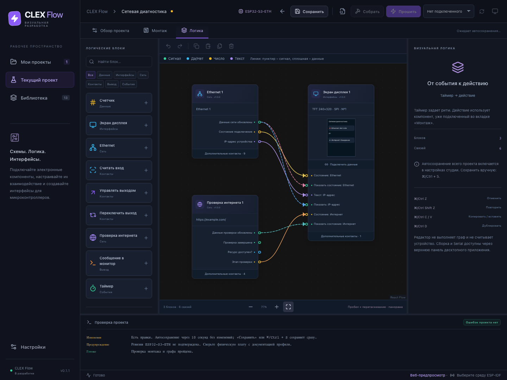
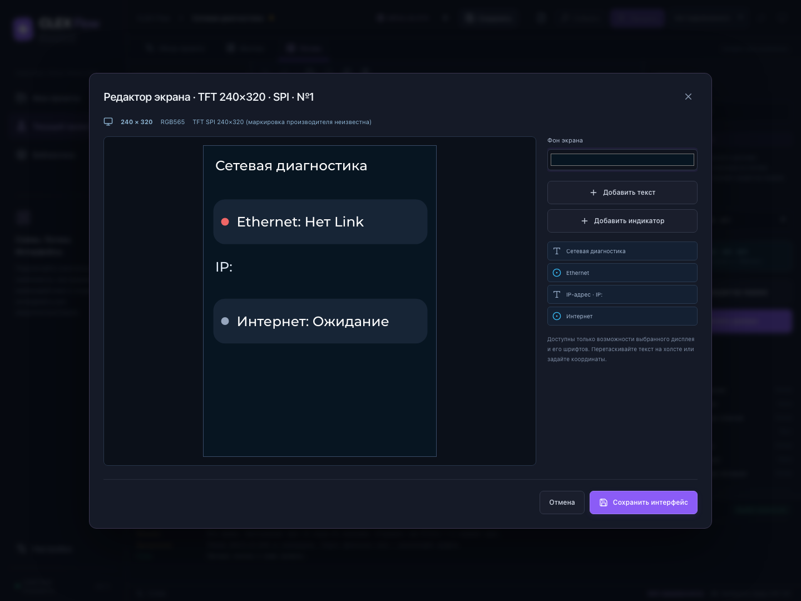

<p align="center">
  
</p>

<h1 align="center">CLEX Flow</h1>
<p align="center">Визуальная среда разработки для микроконтроллеров</p>
<p align="center"><strong>0.1.15 · Предварительная версия · macOS / Windows · MIT</strong></p>

CLEX Flow – визуальная среда разработки для микроконтроллеров. Позволяет создавать схемы подключения, задавать логику работы устройств с помощью блоков, разрабатывать интерфейсы дисплеев, собирать и записывать прошивки. Монтаж, логика и экраны сохраняются в одном проекте.

Поддержка плат разработки на базе **ESP32**, **ESP32-S3**, **ESP32-P4** и **ATmega328P (Arduino Nano)**.



## Возможности

- **Проекты:** хранение в локальных JSON-файлах, поиск, импорт и экспорт. Папку проектов можно разместить на другом диске. Сохранение выполняется вручную или автоматически через 10 секунд без изменений.
- **Платы и компоненты:** поиск по модели и микроконтроллеру, фильтры по семейству и производителю. В «Монтаже» показаны физические подключения, а в «Логике» – события и действия добавленных устройств.
- **Монтаж:** изображения плат, контакты компонентов, проверка GPIO, питания и конфликтов ресурсов. Провода прокладываются автоматически; их маршруты и стороны подключения можно менять вручную. Изменения монтажа можно отменить и повторить.
- **Логика:** события запускают действия, а связи данных передают числа, текст и значения Да/Нет. Доступны таймер, счётчик, секундомер, управление GPIO и сообщения в Serial. Подсказки объясняют назначение контактов; редактор подсвечивает совместимые соединения и проверяет порядок выполнения. [Работа с редактором](docs/logic.md).
- **Условия:** преобразование текста в число, сравнение чисел и диапазонов, проверки текста и значений Да/Нет. Условия можно объединять с помощью И, ИЛИ и НЕ. [Настройка и пример MQTT](docs/numeric-logic.md).
- **Выбор по значению:** выбор действия по числу, тексту или значению Да/Нет. Для чисел и текста можно задать до 16 вариантов. Выбор выполняется по событию и использует последнее значение источника. Поддерживаются ESP32, ESP32-S3, ESP32-P4 и Nano. [Настройка и переключение ESP-NOW](docs/logic-selection.md).
- **MOSFET-ключи и реле:** управление 1-16 каналами, выбор активного уровня HIGH/LOW, включение, выключение и переключение из логики. У реле настраиваются напряжение и источник питания. [MOSFET](docs/mosfet.md), [реле](docs/relays.md).
- **Механические и сенсорные кнопки:** события нажатия и отпускания, проверка текущего состояния и защита от дребезга. Для цифровых сенсорных модулей настраивается активный уровень; редактор проверяет совместимость напряжений. [Сенсорные кнопки](docs/touch-button.md).
- **Шаговые двигатели:** NEMA 17 с драйверами TB6600, MKS TMC2208 V2 и DRV8825 для ESP32, ESP32-S3, ESP32-P4 и Arduino Nano. Движение в шагах или оборотах, непрерывное вращение, разгон, остановка и отключение удержания. Ток и микрошаг на драйвере настраиваются вручную. [Подключение и ограничения](docs/stepper.md).
- **Давление и температура XGZP6847D:** измерение по I²C, выбор питания и коэффициента K, запуск по событию или автоматически. Результаты можно отправить в Serial, на дисплей и в MQTT. Поддерживаются ESP32, ESP32-S3, ESP32-P4 и Arduino Nano. [Подключение и настройка](docs/xgzp6847d.md).
- **Температура микроконтроллера:** встроенный датчик ESP32-S3/P4, измерение по событию или автоматически, вывод на дисплей и в Serial, обработка ошибок. [Настройка и особенности измерения](docs/temperature.md).
- **Дисплеи:** редактор экранов с текстом, индикаторами состояний и PNG-изображениями с прозрачностью. Настраиваются фон, заставка при запуске и шрифты с кириллицей. Элементы экрана отображают числа, текст и состояния устройств; события из логики управляют обновлением интерфейса. Поддерживаются ST7789 SPI и JD9365 MIPI-DSI через ESP-IDF и LVGL. [Подключение и редактор](docs/displays.md).
- **Wi-Fi и Ethernet:** DHCP или статический IPv4, состояние подключения, IP-адрес, маска, шлюз и DNS. Wi-Fi поддерживается на ESP32, ESP32-S3 и ESP32-P4 Nano; на P4 используется ESP32-C6. Для Ethernet доступны W5500 SPI и IP101/RMII. Для контроля доступности HTTP/HTTPS-ресурса задаются адрес, интервал проверки и таймаут. [Wi-Fi](docs/wifi.md), [сеть и индикаторы](docs/network.md).
- **Wi-Fi маршрутизатор:** подключение к интернету через Ethernet или Wi-Fi, раздача по Wi-Fi или Ethernet, IPv4 NAPT, DHCP, локальный DNS и резервное подключение. Поддерживаются ESP32-S3 и ESP32-P4 Nano через ESP-Hosted. Локальное управление защищено аутентификацией; прошивку можно обновлять по сети. [Возможности и ограничения](docs/router.md), [пример ESP32-S3-ETH с дисплеем](examples/router-esp32-s3-eth-test.clex.json).
- **ESP-NOW для ESP32/ESP32-S3:** обмен сообщениями и командами, подтверждение выполнения, шифрование, режимы Normal/Long Range и статистика передачи. Можно сохранять выбранный режим после отключения питания и отслеживать доступность устройств, потерю связи и актуальность RSSI. [Настройка](docs/espnow.md), [сохранение режима](docs/espnow-persistence.md), [контроль связи](docs/espnow-health.md).
- **MQTT 3.1.1 и 5.0:** подключение к брокеру через Wi-Fi или Ethernet, TLS с проверкой сертификата, QoS 0/1/2, LWT, сессии и восстановление подписок. Доступны несколько подключений, отправка и получение текстовых и двоичных сообщений, свойства MQTT 5. [Настройка и ограничения](docs/mqtt.md).
- **Голосовое управление ESP32-P4/S3:** настройка команд и фразы активации, запись образцов произношения через встроенный или внешний микрофон и подготовка моделей распознавания. Распознавание работает локально на плате; действия для команд назначаются в «Логике». Для звукового подтверждения можно воспроизвести запись. [Подготовка и ограничения](docs/voice.md), [внешние микрофоны](docs/microphones.md).
- **Звук и камера ESP32-P4:** звуковой сигнал через ES8311/I2S, захват кадров OV5647/CSI, события результата и диагностика. Монтаж учитывает используемые контакты и конфликты ресурсов.
- **Инструменты разработки:** поиск установленных ESP-IDF и Arduino AVR, выбор рабочего окружения и папки установки. Перед загрузкой показываются недостающие пакеты и их объём. Готовые окружения можно использовать без переустановки. [Управление ESP-IDF](docs/sdk-manager.md).
- **Сборка и запись прошивки:** генерация и просмотр исходного кода, сборка через ESP-IDF или Arduino CLI, выбор USB-порта и загрузка прошивки на плату. Ход сборки отображается в журнале компилятора. Для обмена сообщениями с платой используется монитор последовательного порта: обычно 115200 бод, для голосового компонента – 460800 бод.

CLEX Flow работает локально. Регистрация и облачный сервис не нужны, телеметрия не собирается.

## Монтаж

Выберите плату, добавьте компоненты и соедините их физические контакты. Редактор проверяет допустимость GPIO, конфликты, питание и параметры компонентов.



## Визуальная логика

Соедините событие с нужным действием: например, нажатие кнопки с переключением светодиода или такт таймера с увеличением счётчика. Данные сетевых блоков и датчиков можно вывести на дисплей через «Подключить данные». Все соединения сохраняются в проекте.



## Дисплеи

Дважды нажмите на блок «Экран дисплея», чтобы открыть редактор интерфейса. Сохранённый экран включается в прошивку. Поддерживаются TFT SPI 240×320 на ST7789 и Waveshare 10.1-DSI-TOUCH-A 800×1280 на JD9365 с сенсорной панелью GT9271.



Подробнее: [подключение, шрифты и расширение библиотеки](docs/displays.md).

## Платформы

Установщики доступны для **macOS Apple Silicon (ARM64)** в формате `.dmg` и **Windows x64** в формате `.exe`.

Для сборки прошивок ESP32, ESP32-S3 и ESP32-P4 требуется **ESP-IDF 5.4.4**, для Arduino Nano – **Arduino AVR Boards 1.8.6**. Другие версии этих SDK не поддерживаются.

Платы в каталоге:

- ESP32 DevKit V1 (30 pin), ESP32-WROOM-32: 4 МБ Flash, UART через USB-UART. [Распиновка, совместимость и прошивка](docs/esp32-devkit-v1.md).
- Waveshare ESP32-S3-ETH.
- Espressif ESP32-S3-DevKitC-1 v1.1 N8R8.
- Arduino Nano ATmega328P/CH340G с USB Type-C: Arduino AVR Boards 1.8.6, обычный и старый загрузчик, GPIO, таймер, счетчик, секундомер, Serial и шаговые двигатели. [Подготовка и первый проект](docs/arduino-nano.md).
- ESP32-P4-NANO от Waveshare, включая плату из комплекта KIT-C. Сборка RISC-V, консоль UART через USB-C, GPIO, SPI-дисплей и встроенный Ethernet IP101/RMII. Ревизия ESP32-P4 выбирается в свойствах платы.

Распиновка и встроенные интерфейсы P4: [ESP32-P4-NANO](docs/esp32-p4-nano.md).

Поддерживаемые интерфейсы, распиновка и ограничения указаны в [профилях плат](docs/boards.md).

## Установка

Откройте [GitHub Releases](https://github.com/proxymades/clex-flow/releases) и скачайте установщик предварительной версии для своей системы.

### macOS Apple Silicon

1. Скачайте файл `.dmg` для ARM64, откройте его и перенесите **CLEX Flow** в **Applications / Программы**.
2. Запустите приложение из папки **Программы**.
3. Если macOS блокирует первый запуск, откройте **Системные настройки → Конфиденциальность и безопасность** и разрешите запуск CLEX Flow кнопкой **Все равно открыть**. Разрешайте запуск только файла, скачанного из репозитория проекта.

Сборка для macOS не подписана сертификатом Developer ID и не прошла нотариализацию Apple. Для запуска на ARM64 используется локальная подпись ad-hoc. Подробнее: [Tauri](https://v2.tauri.app/distribute/sign/macos/#ad-hoc-signing), [инструкция Apple](https://support.apple.com/102445).

### Windows x64

1. Скачайте NSIS-установщик `.exe` и запустите его.
2. Следуйте шагам установки и откройте **CLEX Flow** из меню **Пуск**.
3. При предупреждении SmartScreen проверьте источник файла. Для доверенного установщика выберите **Подробнее → Выполнить в любом случае**, если эта возможность доступна. На рабочем компьютере может потребоваться разрешение администратора.

Установщик не подписан сертификатом издателя. Для интерфейса нужен Microsoft Edge WebView2 Runtime; установщик проверяет его наличие. ESP-IDF и компиляторы настраиваются отдельно в разделе «Инструменты разработки»: можно выбрать установленное окружение или установить недостающие пакеты.

## Папка проектов

Откройте **Настройки → Хранилище проектов → Выбрать папку**. Можно выбрать папку на другом доступном диске независимо от места установки CLEX Flow.

При смене папки текущие правки сохраняются, а проекты копируются в новый каталог. Исходные файлы остаются на прежнем месте как резервная копия. Если в выбранной папке уже есть файлы с такими же именами, но другим содержимым, они не перезаписываются: выберите другую папку. Путь сохраняется после перезапуска и обновления CLEX Flow. Если диск недоступен, появится сообщение об ошибке; для продолжения работы подключите его.

## Совместимость проектов

Проекты сохраняются в формате 4. При открытии проектов форматов 1-3 создаётся резервная копия оригинала, затем выполняется преобразование в формат 4. Связи, требующие ручной замены, остаются на схеме с предупреждениями.

Совместимые обновления блоков не требуют их замены. При несовместимом изменении старый блок и его соединения сохраняются, а предупреждение объясняет причину. Добавьте актуальный блок рядом, настройте его и восстановите соединения, затем удалите старый. До замены несовместимых блоков сборка недоступна. [Подробнее о версиях блоков](docs/logic.md#версии-блоков).

## Запуск для разработки

Для разработки нужны **Node.js 22.21.1**, npm и **Rust 1.93.1**. Версии инструментов закреплены в `.nvmrc` и `rust-toolchain.toml`, зависимости – в `package-lock.json` и `Cargo.lock`. На macOS установите Xcode Command Line Tools; на Windows – Build Tools for Visual Studio с инструментами C++ и WebView2. Монтаж, логика и редактор экранов работают без ESP-IDF. Для сборки прошивок ESP32 установите **ESP-IDF 5.4.4** или выберите готовое окружение в разделе «Инструменты разработки».

```sh
git clone https://github.com/proxymades/clex-flow.git
cd clex-flow
npm ci
npm run desktop
```

Сборка приложения:

```sh
npm run desktop:build
```

Результат на macOS: `src-tauri/target/release/bundle/macos/CLEX Flow.app`. Для установщиков `.dmg` (macOS) и `.exe` (Windows) используйте отдельные конфигурации и команды из [руководства по выпуску версий](docs/releases.md).

Для веб-предпросмотра запустите `npm run dev` и откройте `http://127.0.0.1:1420`. В браузере проекты хранятся в localStorage; десктопная версия использует файловое хранилище.

## Технологии

Tauri 2 · Rust · React 19 · JavaScript/JSX · Vite · React Flow · CSS · Lucide · JSON/SVG · ESP-IDF · LVGL

## Проверки

Для тестов индикатора загрузки инструментов нужен Python 3.9+ (`python3` или `python`). ESP-IDF для этих тестов не нужна.

```sh
npm run lint
npm test
npm run build
cargo fmt --manifest-path src-tauri/Cargo.toml --check
cargo test --manifest-path src-tauri/Cargo.toml --locked
npm run test:firmware-parity
```

`test:firmware-parity` проверяет, что генератор JavaScript и нативный слой Rust создают одинаковые файлы прошивки для поддерживаемых конфигураций ESP32/S3/P4/Nano, включая ESP-NOW, маршрутизатор, шаговые двигатели и измерение температуры. Для этой проверки не нужны ESP-IDF, сетевое подключение или плата. Сначала выполните Rust-тесты, чтобы подготовить зависимости.

Проверки интерфейса запускаются через Playwright: `test:ui`, `test:assembly-ui`, `test:logic-ui`, `test:firmware-ui`. Запускайте их при работающем веб-предпросмотре и установленном Chromium. Для P4 и прокладки проводов используются `test:p4-ui`, `test:peripheral-ui`, `test:manual-routing-ui`. Адрес предпросмотра задаётся через `CLEX_PREVIEW_URL`, путь Chromium при необходимости – через `CLEX_BROWSER_EXECUTABLE`. Результаты сохраняются локально в `.artifacts/`.

## Документация

- [Примеры проектов и умный светильник с MQTT](examples/README.md)
- [Синхронизация событий](docs/synchronization.md)
- [SDK Manager](docs/sdk-manager.md)
- [Подключение ESP-IDF и сборка прошивки](docs/esp-idf.md)
- [Профили плат и распиновка](docs/boards.md)
- [Дисплеи и Unicode](docs/displays.md)
- [Сеть и индикаторы состояния](docs/network.md)
- [Wi-Fi маршрутизатор](docs/router.md)
- [Шаговые двигатели](docs/stepper.md)
- [XGZP6847D](docs/xgzp6847d.md)
- [Температура микроконтроллера](docs/temperature.md)
- [Редактор логики](docs/logic.md)
- [Формат проектов](docs/project-format.md)
- [Модули компонентов](docs/module-format.md)
- [Архитектура](docs/architecture.md)
- [Сборка установщиков и выпуск версий](docs/releases.md)
- [Изменения](CHANGELOG.md)

## Лицензия

Оригинальный код – [MIT License](LICENSE). Лицензии и уведомления сторонних библиотек сохранены в [THIRD_PARTY_NOTICES.md](THIRD_PARTY_NOTICES.md).
